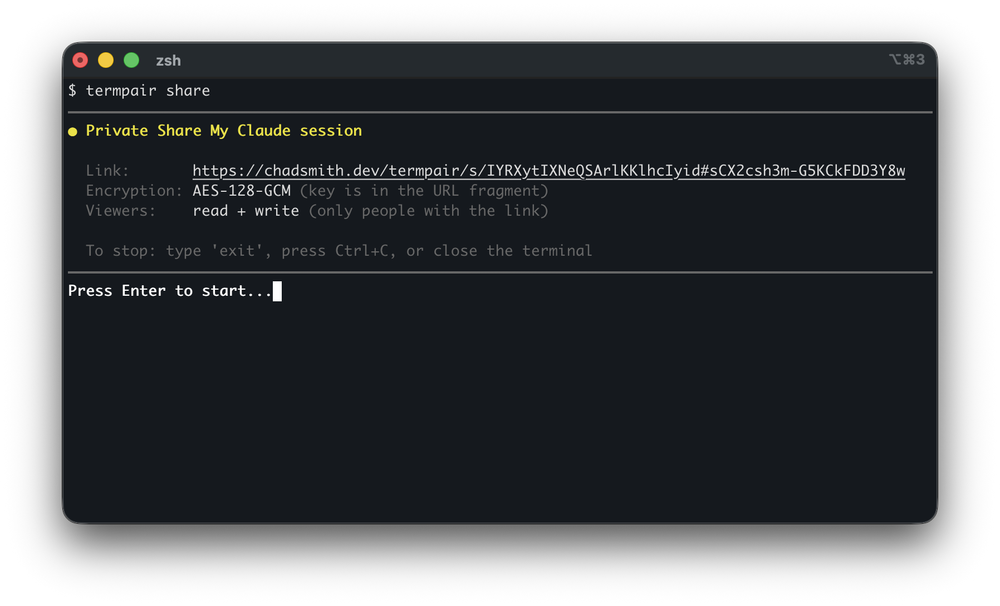
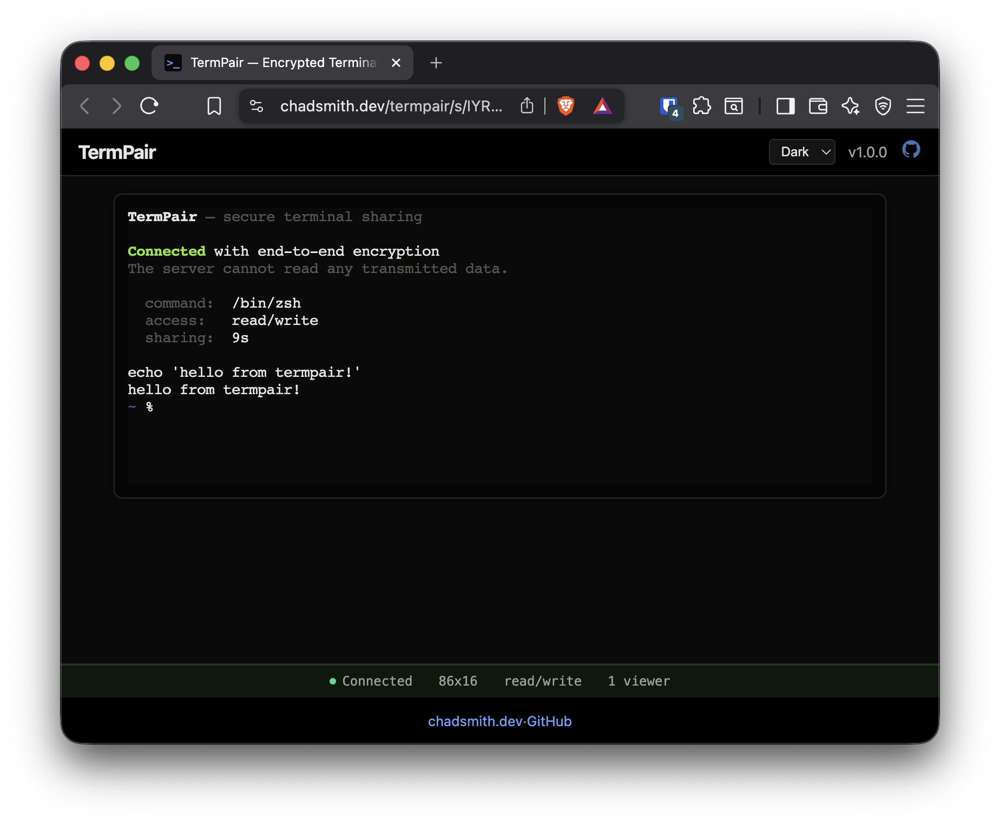

<p align="center">

<br><br>
View and control remote terminals from your browser with end-to-end encryption
<br><br>
</p>

<p align="center">

</p>
<p align="center">

</p>

## Why TermPair?

* **Zero-knowledge sharing** -- your terminal is end-to-end encrypted (AES-128-GCM). The server is a blind relay that never sees your data.
* **One command to share** -- run `termpair`, send the link. Anyone with the link watches your terminal live in their browser.
* **Let others type** -- viewers can type in your terminal from the browser, or set `--read-only` to keep them watching.
* **Public or private** -- private sessions are encrypted and link-only. Public sessions (`--public`) are listed on the landing page for anyone to discover and watch.
* **Survive server restarts** -- if the server goes down, both sides automatically reconnect and resume where they left off.
* **Two standalone binaries, no runtime deps** -- `termpair` runs the terminal client and `termpair-server` relays sessions and serves the embedded web frontend. No Node, Python, or Docker required.
* **Works anywhere** -- Linux, macOS, Windows. Share any terminal app: your shell, vim, htop, Claude Code, anything with a TTY.

## Installation

### Quick Install

```
curl -fsSL https://raw.githubusercontent.com/cs01/termpair/main/install.sh | sh
```

Installs the `termpair` client to `~/.local/bin`; it does not install or run a server. Download the matching `termpair-server` artifact separately from the [releases page](https://github.com/cs01/termpair/releases), or build both binaries from source. Customize the client install with environment variables:

```
INSTALL_DIR=/usr/local/bin sh    # custom install directory
VERSION=v1.2.0 sh               # specific version
```

### GitHub Releases

Download the `termpair` client and/or `termpair-server` binary from the [releases page](https://github.com/cs01/termpair/releases). Separate archives are provided for Linux (x86_64, aarch64), macOS (x86_64, Apple Silicon), and Windows (x86_64).

### Build from Source

```
git clone https://github.com/cs01/termpair.git
cd termpair/termpair-rs
cargo build --release
cp target/release/termpair target/release/termpair-server ~/.local/bin/
```

## Usage

Start the server (on the machine that will relay sessions):

```
termpair-server
```

By default it listens on `localhost:8000`; use `--host` and `--port` to configure the bind address. For remote access, configure TLS with `--certfile` and `--keyfile` or place it behind a TLS-terminating reverse proxy.

On the terminal machine, connect the client to that server and share the session:

```
termpair --host http://localhost --port 8000
```

For a remote server, replace the URL with its externally reachable URL. `termpair` accepts client options directly; there are no `serve` or `share` subcommands.

This prints a URL containing a unique terminal ID and encryption key. Share it with whoever you want to give access. **Anyone with the link can access your terminal** while the session is running.

By default, `termpair` runs your `$SHELL`. The server multicasts terminal output to all connected browsers.

## How it Works

```
┌─────────────────┐                                    ┌─────────────────┐
│                 │    encrypted terminal output        │                 │
│  Terminal       │───────────────────────────────────▶│  Browser(s)     │
│  (termpair      │         ┌───────────────┐          │  (xterm.js +    │
│   share)        │◀────────│  Server       │─────────▶│   Web Crypto)   │
│                 │         │  (blind relay) │          │                 │
│  - forks pty    │    encrypted browser input          │  - decrypts     │
│  - encrypts I/O │         │  never sees   │          │    output       │
│  - manages keys │         │  plaintext    │          │  - encrypts     │
│                 │         └───────────────┘          │    input        │
└─────────────────┘                                    └─────────────────┘
```

The server is a blind relay -- it routes encrypted WebSocket messages without access to keys or plaintext.
The `termpair` client forks a pty, encrypts private-session output with AES-128-GCM, and decrypts browser input.
The separate `termpair-server` binary serves the embedded frontend. Browsers decrypt and render with [xterm.js](https://xtermjs.org/) + [Web Crypto API](https://developer.mozilla.org/en-US/docs/Web/API/Web_Crypto_API).

### Encryption

Three AES-128-GCM keys are created per session:

1. **Output key** -- encrypts terminal output before sending to the server
2. **Input key** -- encrypts browser input before sending to the server
3. **Bootstrap key** -- delivered via the [URL hash fragment](https://developer.mozilla.org/en-US/docs/Web/API/HTMLAnchorElement/hash) (never sent to the server), used to securely exchange keys #1 and #2

Keys are rotated after 2^20 messages. IVs are monotonic counters to prevent reuse.

The browser must be in a [secure context](https://developer.mozilla.org/en-US/docs/Web/Security/Secure_Contexts) (HTTPS or localhost).

## Deployment

### NGINX

```nginx
upstream termpair_app {
  server 127.0.0.1:8000;
}

server {
    server_name myserver.com;
    listen 443 ssl;
    ssl_certificate fullchain.pem;
    ssl_certificate_key privkey.pem;

    location /termpair/ {
        proxy_set_header X-Forwarded-For $proxy_add_x_forwarded_for;
        proxy_set_header Host $host;
        proxy_pass http://termpair_app/;
        proxy_http_version 1.1;
        proxy_set_header Upgrade $http_upgrade;
        proxy_set_header Connection "upgrade";
    }
}
```

### systemd

```ini
# /etc/systemd/system/termpair.service
[Unit]
Description=TermPair terminal sharing server
After=network.target

[Service]
ExecStart=/usr/local/bin/termpair-server --host 127.0.0.1 --port 8000
Restart=on-failure
RestartSec=1s

[Install]
WantedBy=multi-user.target
```

```
sudo systemctl daemon-reload
sudo systemctl enable termpair.service
sudo systemctl restart termpair
```

### TLS

Generate a self-signed certificate:

```
openssl req -newkey rsa:2048 -nodes -keyout host.key -x509 -days 365 -out host.crt -batch
```

Then pass it to the server:

```
termpair-server --certfile host.crt --keyfile host.key
```

## CLI Reference

```
$ termpair-server [OPTIONS]
  -p, --port <PORT>          port to listen on [default: 8000]
      --host <HOST>          host to bind to [default: localhost]
  -c, --certfile <CERTFILE>  path to SSL certificate for HTTPS
  -k, --keyfile <KEYFILE>    path to SSL private key for HTTPS
      --static-dir <DIR>     serve frontend files from this directory
      --theme <THEME>        frontend theme (termpair, sharemyclaude)

$ termpair [OPTIONS]
      --cmd <CMD>             command to run [default: $SHELL]
  -p, --port <PORT>           server port [default: 443]
      --host <HOST>           server URL [default: https://chadsmith.dev/termpair]
  -r, --read-only             prevent browsers from typing
  -b, --open-browser          open the share link in a browser
      --public                public session (no encryption, read-only)
  -y, --yes                   skip confirmation prompt
      --reconnect-timeout N   reconnect timeout in seconds [default: 300]
```

## See Also

**[sharemyclaude](https://github.com/cs01/sharemyclaude)** -- share your Claude Code session with a browser. Built on termpair, with a public relay server so you can share instantly without self-hosting.
